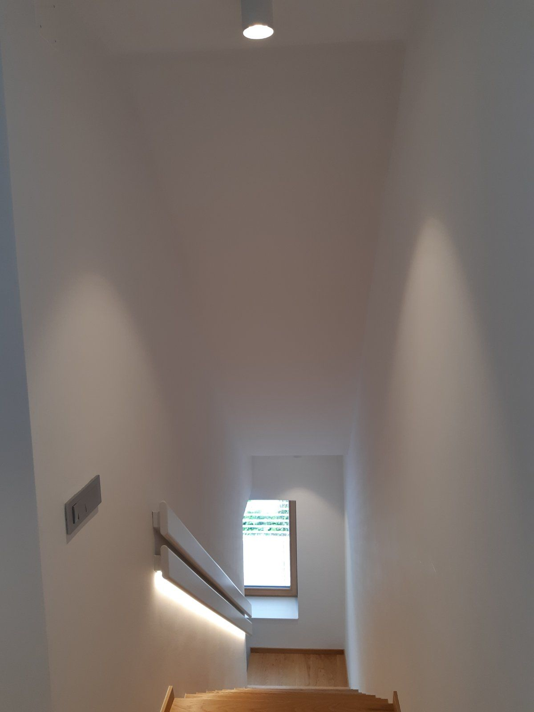

# Spletna stran — ELEKTRO MG (Goran Mikulić s.p.)

Statična spletna stran (HTML + CSS + malo JavaScripta), brez ogrodij in brez
gradnje. Dovolj je, da datoteke naložite na strežnik.

## Struktura

```
index.html              – vsa vsebina strani
assets/
  css/style.css         – oblikovanje
  js/main.js            – meni, animacije, galerija, obrazec
  img/                  – obdelane fotografije in logotip
Slide/, Slike/          – izvirne fotografije (niso potrebne za delovanje strani)
logo*, vizitka*.jpg     – izvirni logotipi in vizitke
```

Fotografije v `assets/img/` so pomanjšane in stisnjene za splet. Izvirniki v
`Slike/` in `Slide/` ostanejo nedotaknjeni, zato jih lahko kadarkoli znova
izvozite v drugi velikosti.

## Kako odpreti

Dvoklik na `index.html` (odpre se v brskalniku). Za pravi predogled delovanja
zemljevida in pisav priporočam lokalni strežnik:

```bash
python3 -m http.server 8000
# odprite http://localhost:8000
```

## Objava

Naložite vse datoteke (`index.html` in mapo `assets/`) v korensko mapo gostovanja
(npr. Neoserv, Domenca, Arnes, Netlify, Cloudflare Pages). Vse poti so relativne,
zato deluje tudi v podmapi.

Po objavi priporočam:

1. v `index.html` v `<head>` dodajte `<link rel="canonical" href="https://vasa-domena.si/">`;
2. posodobite `og:image` na polno povezavo (`https://vasa-domena.si/assets/img/hero.jpg`);
3. v `index.html` v JSON-LD (`Electrician`) dodajte `"url": "https://vasa-domena.si"`.

## Kje se ureja vsebina

Vse je v `index.html`, razdeljeno po odsekih z jasnimi komentarji:

| Odsek | Kaj je notri |
|---|---|
| `hero` | naslovna slika, glavni naslov, dva gumba |
| `intro` | kdo smo + štiri izhodišča (01–04) |
| `#storitve` | osmih storitev v karticah |
| `#projekti` | galerija (klik odpre povečavo) |
| `#o-nas` | besedilo o podjetju, slika, seznam prednosti |
| `#postopek` | štirje koraki |
| `cta-band` | vmesni poziv k telefonu |
| `#vprasanja` | pogosta vprašanja (`<details>`) |
| `#kontakt` | kontaktni podatki, obrazec, zemljevid |
| `footer` | podnožje s podatki podjetja |

### Barve in pisave

V `assets/css/style.css` na vrhu, v `:root`:

```css
--red: #ee1e3a;   /* barva logotipa */
--ink: #12141a;   /* temna */
--alt: #f5f6f8;   /* svetla podlaga */
--container: 1200px;
```

Pisavi sta naloženi iz Google Fonts (`Outfit` za naslove, `Inter` za besedilo).
Če želite stran brez zunanjih povezav, pisave prenesite lokalno in zamenjajte
`<link>` v `<head>`.

### Galerija

Vsaka slika je gumb:

```html
<button class="gallery-item" type="button"
        data-full="assets/img/projekt-01.jpg"
        data-caption="Opis, ki se pokaže v povečavi">
  
  <span class="gallery-cap">Kratek napis na sliki</span>
</button>
```

Dodatek `gallery-item--tall` naredi sliko dvakrat višjo (uporabno za pokončne
fotografije).

### Obrazec

Obrazec trenutno **ne pošilja podatkov na strežnik** – sestavi e-poštno sporočilo
in odpre uporabnikov poštni program (`mailto:`). To deluje brez zaledja, a nekateri
uporabniki (predvsem na telefonu brez nastavljenega e-poštnega računa) ga ne morejo
poslati.

Če želite pravo pošiljanje, je najhitrejša pot brez lastnega strežnika storitev, kot
je [Formspree](https://formspree.io) ali [Web3Forms](https://web3forms.com):

1. v `index.html` spremenite `<form ... action="..." method="post">` na naslov, ki
   ga dobite pri ponudniku;
2. v `assets/js/main.js` v funkciji `form.addEventListener('submit', ...)` odstranite
   vrstico, ki nastavi `window.location.href = 'mailto:...'`, in pustite običajno
   pošiljanje obrazca.

## Dostopnost in delovanje

- semantična struktura (`header`, `nav`, `main`, `section`, `footer`),
- povezava »Preskoči na vsebino«,
- vsi gumbi in povezave so dosegljivi s tipkovnico, povečava se zapre z `Esc`,
- slike imajo `alt`, dekorativne pa prazen `alt`,
- animacije se izklopijo ob nastavitvi »zmanjšaj gibanje«,
- stran je odzivna (prelomi pri 1100, 900 in 620 px).

## Podatki podjetja, uporabljeni na strani

- ELEKTRO MG, Goran Mikulić s.p.
- Ulica Matije Tomca 2, 1230 Domžale
- 031 622 567, mikulic.goran@gmail.com
- Davčna št.: SI58655859, matična št.: 8989354000

Pred objavo preverite, ali so vsi podatki in besedila še točni.
